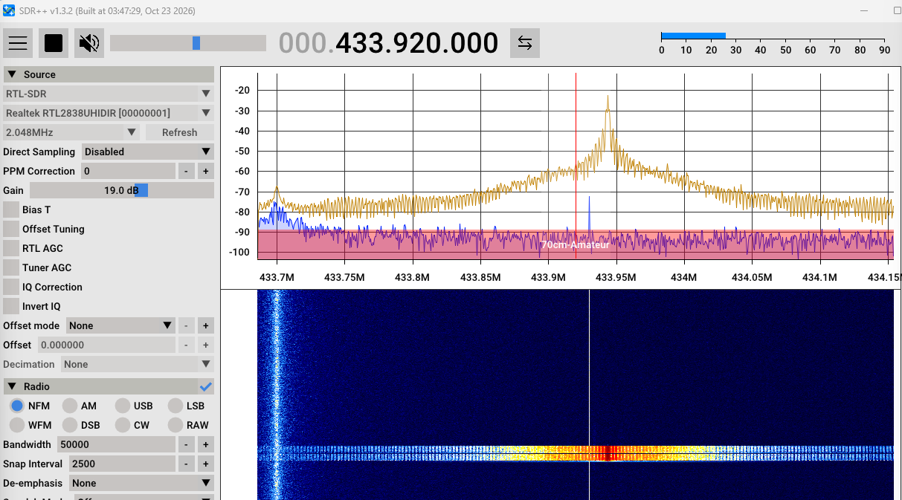
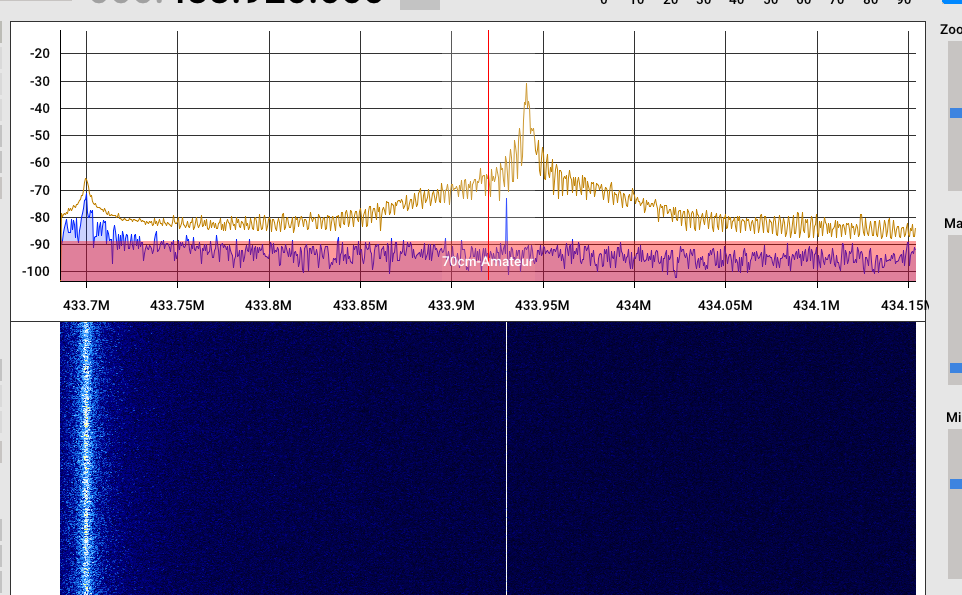
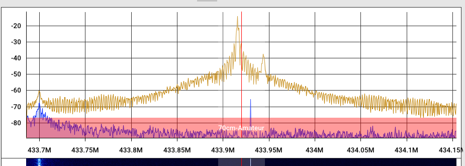
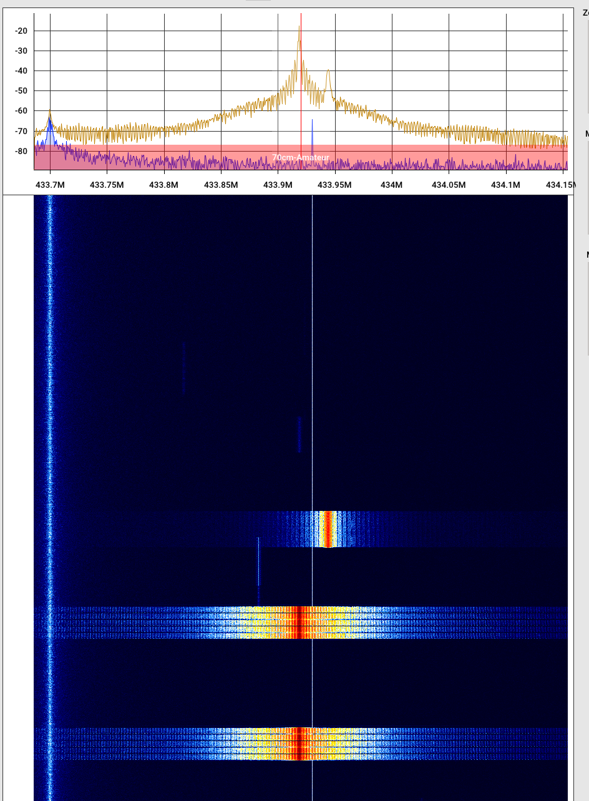
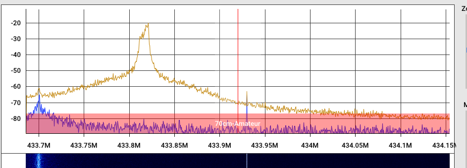

# Funkanalyse und Verbesserungen der Sendestrecke (November 2026)

Diese Notiz dokumentiert eine Untersuchung mit einem SDR-Empfänger an zwei Controllern mit dieser Firmware und die daraus entstandenen Änderungen.

## Ausgangslage

- Zwei Controller mit nahezu identischer Hardware (CC1101-Modul, Drahtantenne bzw. Stabantenne):
  - **ESP32** (Dual-Core, „ESP32-mini“): funktionierte meistens.
  - **ESP32-S2** (Single-Core, Lolin S2 mini): setzte kaum einen Befehl erfolgreich ab; bei aktivem MQTT gab es zusätzlich gelegentliche Resets.
- Die Motoren reagierten teils gar nicht, teils erst nach mehrfachem Senden.

## Messaufbau

- SDR: NooElec NESDR SMArTee XTR (RTL2832U + E4000, TCXO 0,5 ppm) mit SDR++
- Samplerate 2,048 MSPS, Gain fest 19 dB, AGC aus, FFT-Größe 65536, FFT Hold
- Abstand Sender – SDR 2,5 m bzw. 12,5 m, nahezu Sichtverbindung
- Frequenzwerte sind aus den Screenshots abgelesen (Genauigkeit etwa ±2 kHz)

## Befund 1: Trägerfrequenz 25 kHz zu hoch

Die Firmware programmierte `FREQ = 0x10B0B0`:
`26 MHz × 0x10B0B0 / 2^16 = 433,9448 MHz`

Beide Controller sendeten gemessen auf etwa 433,943 MHz, die Quarze waren also genau; die Abweichung kam allein aus dem Registerwert (aus dem Vorprojekt übernommen).

| vorher ESP32-S2 | vorher ESP32 |
|---|---|
|  |  |

Mit `FREQ0 = 0x71` (`0x10B071` = 433,9198 MHz) liegen beide Sender auf 433,92 MHz (rote Linie = 433,920 MHz). Diese Korrektur ist bereits in `main` (Commit 7f0f4be).

| nachher ESP32 | nachher ESP32-S2 |
|---|---|
|  |  |

Zum Vergleich eine Original-Jarolift-Fernbedienung: sie sendet auf etwa **433,814 MHz** (rund 106 kHz unter 433,92 MHz) und wird trotzdem verstanden. Die Empfänger in den Motoren sind also sehr breitbandig – die Frequenz war **nicht** die Hauptursache der Ausfälle, 433,92 MHz ist aber der saubere Sollwert.



(Der kleinere Puls bei etwa 433,944 MHz im Bild „nachher ESP32“ stammt von einem fremden Sender; er war auch bei abgeschalteten Controllern zu sehen.)

## Befund 2: Verschobene Bits beim ESP32-S2 → Senden per RMT

Der zweite Controller (ESP32) empfängt die Telegramme des S2 mit. Im Log tauchte dieselbe Seriennummer in vielen „verschobenen“ Varianten auf:

| empfangen | Verhältnis zu 0x01305006 |
|---|---|
| 0x00982803 | 1 Bit nach rechts |
| 0x004C1401 | 2 Bit nach rechts |
| 0x0260A00C | 1 Bit nach links |
| 0x00982802, 0x0260A00D, 0x02609006 | 1 Bit verschoben + Bitfehler |

Ursache: Die Pulse wurden mit `digitalWrite()` / `delayMicroseconds()` erzeugt (ca. 100 ms pro Telegramm). Auf dem **Single-Core-ESP32-S2** unterbrechen WLAN-Interrupts und Systemtasks diese Schleife, einzelne Pulse werden um einige hundert µs zu lang und der Empfänger verzählt sich. Auf dem Dual-Core-ESP32 laufen WLAN und Programm auf getrennten Kernen, deshalb trat das dort kaum auf.

**Änderung:** Das komplette Telegramm wird als RMT-Symbole (86 Symbole, 1 µs Auflösung) aufgebaut und von der RMT-Hardware ausgegeben. Pulslängen, Präambel, Sync-Pause und die 16 ms zwischen Wiederholungen sind unverändert, aber jetzt mikrosekundengenau. Während der Ausgabe wartet der Task blockierend auf das Ende (Semaphore), WLAN und MQTT laufen weiter. Das sollte auch die MQTT-Resets auf dem S2 beheben (in den bisherigen Tests traten keine mehr auf).

## Befund 3: Sendeleistung wurde nie gesetzt

```cpp
cc1101_.init();                          // schreibt PATABLE[0] = paTableByte (0x60)
...
cc1101_.setTxPowerAmp(PA_LongDistance);  // ändert nur die Variable -> keine Wirkung
```

Gesendet wurde mit 0x60 (etwa 0 dBm) statt 0xC0 (etwa +10 dBm).

**Änderung:** `setTxPowerAmp(PA_LongDistance)` wird **vor** `init()` aufgerufen; `init()` schreibt den Wert wie bisher per Einzelzugriff.

**Wichtiger Hinweis für spätere Änderungen:** Die CS-Leitung des CC1101 wird nie auf HIGH gesetzt (`SPI.begin()` treibt CS nicht, der Pin bleibt nach `pinMode(OUTPUT)` dauerhaft LOW). Ein **Burst-Zugriff** (`writeBurstReg`) wird beim CC1101 aber erst mit CS = HIGH beendet. Ein erster Versuch, PATABLE[0..1] per Burst zu schreiben, hat deshalb alle folgenden SPI-Kommandos (STX, Statusabfragen) als PATABLE-Daten verschluckt – der Sender war stumm, MARCSTATE las 0x1F. Burst-Zugriffe also nur mit echter CS-Steuerung verwenden.

Zur Zuordnung der PATABLE im asynchronen OOK-Modus (FREND0 = 0x11): GDO0 LOW = Träger an = PATABLE[0], GDO0 HIGH = Träger aus = PATABLE[1].

## Befund 4: Wiederholungen

UP/DOWN wurden nur 2-mal gesendet (ca. 0,23 s). Eine gestörte Wiederholung reichte, um den Befehl zu verlieren.

**Änderung:** UP/DOWN werden 5-mal gesendet (alle mit demselben Zählerstand, der Motor führt den Befehl nur einmal aus). **STOP bleibt bei 2**, weil ein wiederholtes/gehaltenes STOP vom Motor als eigene Funktion (Zwischenposition/Shade) gewertet wird. SHADE (20-mal), Anlern- und Endpunkt-Sequenzen sind unverändert.

## Befund 5: WLAN im Mesh (FRITZ!Repeater)

Der S2 hing trotz eines Repeaters in 2 m Entfernung mit −72 dBm an einem entfernten Access Point, mit gelegentlichen Abbrüchen. `WiFi.begin()` verbindet sich standardmäßig mit dem **ersten** gefundenen AP, und der ESP32 unterstützt kein Mesh-Steering (802.11k/v).

**Änderungen:**
- Vor jedem Verbinden: Scan aller Kanäle und Auswahl des stärksten AP (`WIFI_ALL_CHANNEL_SCAN`, `WIFI_CONNECT_AP_BY_SIGNAL`). Ergebnis: −49 dBm.
- Periodisches Roaming (ähnlich Tasmota SetOption57): alle 30 Minuten asynchroner Scan nach der eigenen SSID; ist ein anderer AP mindestens 8 dB stärker, wird gezielt auf dessen BSSID umgeschaltet.
- Log nach dem Verbinden: `WiFi AP: BSSID … | channel … | RSSI … dBm`

## Befund 6: Phantom-Telegramme beim Empfang

Im Log tauchten „remote signal“-Einträge auf, obwohl im SDR nichts gesendet wurde, z. B. `serial: 0x0ffeffbf | cmd: 0xb`. Ursache: Ohne Sender regelt die AGC des CC1101 das Rauschen hoch (normal bei OOK im asynchronen Modus, die AGC-Einstellungen entsprechen den TI-Empfehlungen). Ab und zu sieht eine Lücke wie ein Sync-Puls aus, und der Rest wurde ohne Prüfung „dekodiert“. Je nach Standort (Nähe zu Repeater/PC) kam das bis zu einmal pro Sekunde vor.

**Änderung:** Ein Telegramm wird nur ausgewertet, wenn
1. jedes Bit aus einem Ein- und einem Aus-Puls von 300–1000 µs mit einer Periode von 900–1500 µs besteht und
2. der entschlüsselte Hopcode in Bit 16–23 das Low-Byte der Seriennummer enthält (KeeLoq-Diskriminierung; nur mit dem Herstellerschlüssel prüfbar, unabhängig davon, ob die Seriennummer gespeichert ist).

Unbekannte Jarolift-Fernbedienungen werden weiterhin angezeigt. Verworfene Telegramme erscheinen nur im Debug-Log (`RX discarded (pulse timing|KeeLoq check)`).

Die Empfangsbandbreite (ca. 270 kHz) blieb dabei unverändert. Original-Fernbedienungen liegen bis über 100 kHz neben 433,92 MHz; nach Befund 7 reicht die Bandbreite für die TDRC16 (−106 kHz) nicht aus.

## Befund 7: Empfangsversuche – Stand und offene Punkte

Mit der RX-Statistik (`RX stat/min`) und dem Telnet-Befehl `cc1101` wurden die Empfangseinstellungen untersucht. Die damaligen Standardwerte waren MDMCFG4 = 0x69, AGCCTRL2 = 0x04, AGCCTRL0 = 0x92; inzwischen gelten die Werte aus Befund 8.

### Rauschpulse am GDO2-Ausgang

Im Ruhezustand liefert der CC1101 mit den Standardwerten rund **10.000 Flanken pro Sekunde** (Rauschen bei voll aufgeregelter AGC, OOK-Slicer schaltet). Jede Flanke ist ein Interrupt mit `digitalRead()`/`micros()`. Auf dem Single-Core-ESP32-S2 ist das eine erhebliche Dauerlast.

Messreihe ESP32-S2 (Standort ohne nennenswerte Störungen, RSSI ca. −104 dBm), nur über Telnet gesetzt:

| AGCCTRL2 / AGCCTRL0 | Bedeutung | Flanken/min |
|---|---|---|
| 0x04 / 0x92 (Standard) | AGC-Ziel 36 dB, OOK-Schwelle 12 dB | 630.000–870.000 |
| 0x04 / 0x93 | OOK-Schwelle 16 dB | ~19.500 |
| 0x04 / 0xD3 | + Hysterese groß | ~18.000 |
| 0x03 / 0xD3 | + AGC-Ziel 33 dB | **~800** |
| 0x43 / 0xD3 | + höchste DVGA-Stufe gesperrt | ~470.000 (schlechter) |
| 0x83 / 0xD3 | + zwei DVGA-Stufen gesperrt | ~200.000 |

OOK-Schwelle, Hysterese und AGC-Ziel senken die Interrupt-Last um etwa Faktor 1000. Das Sperren von DVGA-Stufen ist kontraproduktiv.

### Empfang von Sendern

- **Original-Fernbedienung TDRC16** (gemessen ca. 433,814 MHz, also −106 kHz): wird **weder mit den Standardwerten noch mit den geänderten Werten** empfangen – kein Sync, kein verworfenes Telegramm. Die Empfangsbandbreite von ca. 270 kHz (±135 kHz) reicht für diesen Versatz offenbar nicht. Vor der Frequenzkorrektur lag die Empfangsmitte bei 433,945 MHz (−131 kHz Versatz), der Empfang dürfte also auch früher schon nicht funktioniert haben.
- **Controller untereinander** (1 m Abstand, beide auf 433,92 MHz): nicht reproduzierbar – mal wird empfangen, mal nicht; der S2 hört den ESP32 meist, umgekehrt seltener. Vermutung: Übersteuerung bzw. AGC-Einschwingen bei sehr starkem Signal nach langer Ruhe.
- Der ESP32 (zweites Gerät) hatte am selben Standort einen um ca. **20 dB höheren Grundpegel** (RSSI −68 … −91 dBm statt −104 dBm). Ursache ungeklärt (gerätebedingt, da 1 m Abstand zum S2).

### Offene Ideen für später

- Empfangsbandbreite erhöhen (MDMCFG4 oberes Nibble: 0x59 = 325 kHz, 0x49 = 406 kHz, 0x39 = 464 kHz), Wirkung auf TDRC16-Empfang und Rauschflanken prüfen – noch nicht getestet.
- AGC-Werte 0x03/0xD3 als Standard erst nach erfolgreichem Empfangstest übernehmen.
- Wiederholungen eines Tastendrucks (gleiche Seriennummer + gleicher Zähler) nur einmal auswerten – derzeit wird jede empfangene Wiederholung einzeln verarbeitet (Positionsberechnung, Speichern der Konfiguration).
- Empfang per RMT-RX statt GPIO-Interrupt, um die Interrupt-Last unabhängig vom Rauschen zu machen.

### Werkzeuge

```
cc1101 agc          AGC-/RX-Register, RSSI, MARCSTATE anzeigen
cc1101 r <reg>      Register lesen (hex)
cc1101 w <reg> <v>  Config-Register schreiben (hex, nur bis zum Neustart)
```

Debug-Log: `RX stat/h: …` (stündliche Zusammenfassung), Info: `RX disturbed: …` bei Überschreiten der Schwellwerte, Telnet `cc1101 stat` (letzte Minute) sowie `RX diag: …` für verworfene Telegramme.

## Befund 8: Empfangseinstellungen von SIGNALduinoAdv (Ralf9)

Die Werte aus Bank 0 („SlowRF“) des SIGNALduinoAdv von Ralf9 wurden per Telnet getestet und danach fest übernommen:

| Register | vorher | neu (Ralf9) | Bedeutung |
|---|---|---|---|
| MDMCFG4 | 0x69 | 0x57 | RX-Filter 325 kHz (statt 270 kHz), DRATE_E 7 |
| MDMCFG3 | 0xE4 | 0xC4 | Datenrate ≈ 5,6 kBaud (statt ≈ 24 kBaud) |
| AGCCTRL2 | 0x04 | 0x07 | AGC-Ziel 42 dB |
| AGCCTRL0 | 0x92 | 0x91 | OOK-Entscheidungsschwelle 8 dB |
| FREND1 | 0xB6 | 0x56 | |
| FIFOTHR | 0x47 | 0x07 | |
| TEST2 / TEST1 | 0x81 / 0x35 | 0x88 / 0x31 | |

Ergebnis: Die Original-Fernbedienung TDRC16 (≈ 433,82 MHz) wird empfangen, die Controller hören sich gegenseitig deutlich zuverlässiger. Senden ist nicht betroffen (asynchroner Modus).

Eine SDR-Aufnahme der TDRC16 (demoduliert, 48 kHz) zeigt: Präambel mit einem langen Puls (1,5–2,2 ms) und 12–13 Pulsen ≈ 400/400 µs, Sync-Lücke 3,96–3,98 ms, 72 Bits mit Periode 1,17–1,25 ms, kurze Pulse 290–420 µs, lange 770–810 µs. Jeder Code wird zweimal im Abstand von ca. 16 ms gesendet, bei gehaltener Taste folgt etwa alle 340 ms der nächste Zählerstand. Weil die kurzen Pulse teils unter 300 µs lagen, akzeptiert die Empfangsroutine jetzt Pulse ab 200 µs.

Hinweis: Die empfindlicheren Einstellungen liefern im Ruhezustand wieder viele Rauschflanken (Interrupt-Last); die Plausibilitätsprüfung (Befund 6) verwirft die daraus entstehenden Phantom-Telegramme.

Zusätzlich:
- **Glitch-Filter:** Ein Störimpuls unter 200 µs mitten in einem Puls zerschnitt diesen bisher in zwei Teile (Folge: Pulsprüfung schlug fehl oder die Bits wurden verschoben gelesen, z. B. Seriennummer 0x01B90003 statt 0x03720007). Jetzt werden beide Flanken eines solchen Impulses verworfen und der umgebende Puls vollständig gemessen.
- **RX-Statistik:** intern pro Minute gemessen, im Debug-Log nur noch als stündliche Zusammenfassung; bei mehr als 50.000 Flanken/min oder mindestens 5 verworfenen Telegrammen/min sofort eine Info-Meldung `RX disturbed` (höchstens alle 10 min).

Mit den Werten von Ralf9 sinken auch die Rauschflanken im Ruhezustand deutlich (S2: von 630.000–870.000 auf ca. 1.000–4.000 pro Minute), vermutlich wegen der niedrigeren Datenrate.

## Befund 9: Empfangsqualität hängt stark vom Hardware-Aufbau ab

Vergleich der beiden Controller am selben Ort (1 m Abstand), gleiche Firmware und Einstellungen:

| | ESP32-S2 (CC1101 fest aufgelötet) | ESP32 „mini“ |
|---|---|---|
| RSSI in Ruhe | −95 … −100 dBm | −59 … −67 dBm |
| Flanken/min in Ruhe | ca. 2.000–4.000 | ca. 25.000 (vor Entstörung 50.000–90.000) |
| TDRC16-Test (vor Entstörung des mini) | 9 ok / 0 verworfen | 3 ok / 10 verworfen |

Beobachtungen:
- Der ESP32 „mini“ stört seinen eigenen Empfänger, auch an einer eigenen Powerbank. An einer gemeinsamen Powerbank hat er zusätzlich den S2 gestört (dessen Flanken stiegen auf ca. 90.000/min).
- Ferrit an der Versorgung brachte wenig, Entstörkondensatoren am mini deutlich mehr (Flanken etwa Faktor 5 weniger). Der um ca. 25–35 dB höhere RSSI blieb – auch mit 30 cm abgesetztem CC1101-Modul und 10 nF direkt am Modul.
- Dasselbe steckbare CC1101-Modul erreicht am S2 ca. −80 dBm, am mini deutlich schlechter.
- Fazit: Die Empfangsschwäche ist im Zusammenspiel mit diesem ESP32-Board systembedingt. Für guten Empfang ist der Hardware-Aufbau (Board, Versorgung, Verdrahtung, Lage der Antenne) entscheidend; ein fest aufgelöteter Aufbau wie beim S2 empfängt deutlich besser.
- Der S2 zeigte zweimal einen Zustand mit dauerhaft stark erhöhter Flankenzahl bei unverändertem RSSI (u. a. nachdem er wenige Zentimeter neben dem mini lag), der erst durch Aus- und Einschalten verschwand. Ursache ungeklärt; als Test im gestörten Zustand vorgesehen: `cc1101 w 1d 91` (IDLE → RX mit Neukalibrierung), dann `restart`.

## Diagnose im Log

Nach jedem Senden:

```
I JARO-LIB: TX via RMT: 86 symbols, 5/5 repetitions sent, MARCSTATE 0x13
```

- `86 symbols, n/n`: RMT hat alle Wiederholungen ausgegeben
- `MARCSTATE 0x13` (0x13–0x15): CC1101 war im Sendezustand

Falls der GDO0-Pin von einem anderen Treiber übernommen wurde, wird RMT automatisch neu initialisiert (Warnung im Log).

## Ergebnis

Mit allen Änderungen führt der Motor am ESP32-S2 jeden Befehl aus, auch kurz hintereinander gesendete; in den bisherigen Tests traten keine Resets mehr auf. Beide Controller senden auf 433,92 MHz.

## Hinweis für Anwender

Zwei Controller dürfen **nicht dieselbe Seriennummer** verwenden. Jeder Controller führt seinen eigenen Zähler; der Motor verwirft Telegramme mit einem Zählerstand, der hinter dem zuletzt akzeptierten liegt. Bei gleicher Seriennummer funktioniert dann meist nur einer der beiden zuverlässig.

## Commits

1. TX: Telegramme per RMT statt Software-Timing senden
2. CC1101: Sendeleistung – zunächst per Burst, siehe Befund 3, korrigiert in Schritt 6
3. TX: UP/DOWN/STOP 5-mal statt 2-mal senden
4. TX: STOP wieder nur 2-mal senden
5. TX: RMT-Diagnose und automatische Neuinitialisierung
6. CC1101: PATABLE nicht per Burst schreiben (setTxPowerAmp vor init)
7. WiFi: im Mesh mit dem stärksten Access Point verbinden
8. WiFi: periodisches Roaming zum stärksten Access Point
9. WebUI: Logbuch in kleinen Paketen senden
10. OTA: Flash-Belegung nur einmal ermitteln (behebt bootloader_mmap failed, #18)
11. WebUI: Positionsregler live aktualisieren
12. RX: Rauschen verwerfen (Pulstiming- und KeeLoq-Prüfung)
13. WiFi-Roaming: Scanwerte vergleichen, Log verständlicher
14. RX: Diagnose für verworfene Telegramme (Debug)
15. Log: Roaming- und RX-Diagnosezeilen kürzen
16. RX: Statistik pro Minute im Debug-Log
17. Telnet: Befehl cc1101 zum Lesen/Schreiben von Registern
18. CC1101: Empfangseinstellungen von SIGNALduinoAdv (Ralf9) übernehmen
19. RX: kurze Pulse ab 200 µs akzeptieren
20. RX: Störspitzen innerhalb eines Pulses herausfiltern
21. RX-Statistik: stündliche Zusammenfassung statt Minutenmeldung
